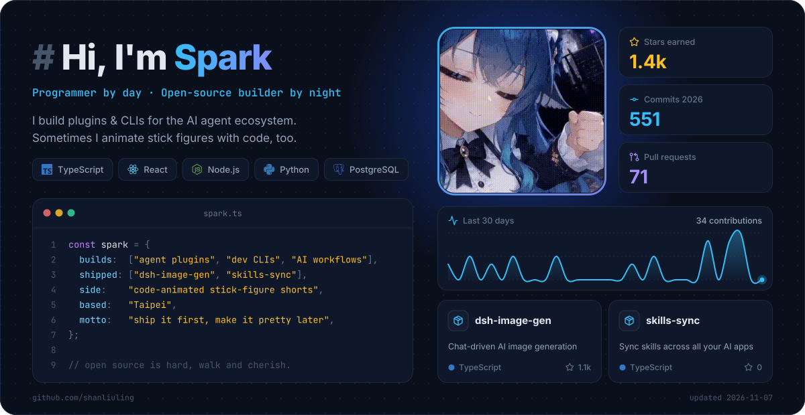

<picture>
  <source media="(prefers-color-scheme: dark)" srcset="https://raw.githubusercontent.com/shanliuling/shanliuling/output/profile.svg">
  <source media="(prefers-color-scheme: light)" srcset="https://raw.githubusercontent.com/shanliuling/shanliuling/output/profile-light.svg">
  
</picture>

  
  
  
  

